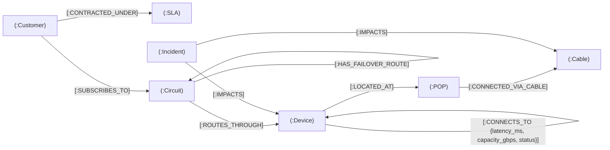

# Software Design Document (SDD)
## Project: NetContext – Enterprise Network & SLA Context Graph Platform

**Target Role:** Forward Deployed Engineer – Context Graph (Tata Communications)  
**Author:** Candidate (with Antigravity AI Pair Programmer)  
**Date:** October 2026  
**Status:** DRAFT / APPROVED FOR IMPLEMENTATION  
**Version:** 2.0.0 (Enhanced with Real Data Sources, Enterprise Security, & Real-Time Event Streaming)

---

## 1. Executive Summary & Business Problem

### 1.1 Business Context (Tata Communications)
Tata Communications operates critical global digital infrastructure: Tier-1 subsea fiber cable networks (AS6453), global SD-WAN backbones, multi-cloud interconnects, and IoT connectivity platforms. Enterprise clients (multinational banks, airlines, logistics giants) pay millions annually under stringent Service Level Agreements (SLAs). 

### 1.2 The Problem
When a physical or logical failure occurs (e.g., undersea fiber cut, router hardware crash, BGP misconfiguration), operations teams face critical operational bottlenecks:
1. **Data Silos:** Network device health (SNMP/telemetry), logical routing circuits, and customer SLA contracts reside in disconnected systems (CMDB, Monitoring tools, CRM/Billing).
2. **Blind Blast-Radius:** Engineers cannot instantly calculate which enterprise customers and high-value contracts are impacted by a specific node failure.
3. **Vector RAG Inadequacy:** Generic Large Language Models (LLMs) paired with traditional Vector RAG fail at topological network troubleshooting because vector similarity cannot perform multi-hop path traversals across hardware, logical routing, and commercial contracts.
4. **Financial Penalties:** SLA breach costs accumulate by the minute. Uncoordinated incident response causes preventable contract penalties.

### 1.3 The Solution: NetContext
**NetContext** is a microservices-based enterprise Context Graph platform. It ingests **real-world Tata Communications global network assets** (via PeeringDB and TeleGeography APIs), models physical infrastructure, logical circuits, and customer SLA contracts into **Neo4j**, and processes **real-time telemetry event streams**. It leverages **GraphRAG (Graph-Augmented Retrieval-Augmented Generation)** to translate natural language inquiries from engineers into Cypher queries, compute topological blast radius, and provide explainable, automated Root Cause Analysis (RCA).

---

## 2. Domain Ontology & Data Ingestion Strategy

### 2.1 Entity Classes (Nodes)

| Node Label | Key Properties | Description |
| :--- | :--- | :--- |
| `:Customer` | `id`, `name`, `industry`, `tier` (`TIER_1`, `TIER_2`, `TIER_3`) | Enterprise business entity purchasing network services. |
| `:SLA` | `id`, `tier`, `max_downtime_minutes`, `penalty_per_minute_usd`, `target_availability_pct` | Contractual SLA legal obligations and penalty structures. |
| `:Circuit` | `id`, `bandwidth_gbps`, `protocol` (`MPLS`, `SD_WAN`, `INTERNET`), `status` (`UP`, `DEGRADED`, `DOWN`), `role` (`PRIMARY`, `BACKUP`) | Logical data transport circuit provisioned for a customer. |
| `:Device` | `id`, `name`, `model`, `role` (`CORE_ROUTER`, `EDGE_ROUTER`, `GATEWAY`), `ip`, `status` (`HEALTHY`, `FAILED`, `MAINTENANCE`) | Physical or virtual network appliance. |
| `:POP` | `id`, `name`, `city`, `country`, `region` (`APAC`, `EMEA`, `AMER`), `lat`, `lon`, `facility` | Point of Presence (real data center or cable landing station). |
| `:Cable` | `id`, `name`, `landing_points`, `capacity_tbps`, `status` (`ACTIVE`, `CUT`, `DEGRADED`) | Real subsea fiber optic cable system (e.g., TGN-Atlantic, TGN-TIC). |
| `:Incident` | `id`, `severity` (`CRITICAL`, `MAJOR`, `WARNING`), `status` (`OPEN`, `INVESTIGATING`, `RESOLVED`), `started_at`, `description` | Real-time network alert or failure event. |

---

### 2.2 Relationship Schema (Edges)



---

### 2.3 Real-World Data Ingestion Sources (Tata Communications AS6453)

To ensure maximum realism and credibility, NetContext leverages real public datasets and APIs:

1. **PeeringDB API (`https://www.peeringdb.com/api/net/135`)**:
   * Pulls Tata Communications' (ASN 6453) real global Points of Presence (POPs), Internet Exchange Points (IXPs), and colocation facilities across Singapore, Mumbai, London, Frankfurt, New York, Tokyo, etc.
2. **TeleGeography Submarine Cable Map Open Dataset**:
   * Pulls actual subsea cables owned or operated by Tata Communications:
     * **TGN-Atlantic** (UK $\leftrightarrow$ US)
     * **TGN-Pacific** (US $\leftrightarrow$ Japan)
     * **TGN-TIC** (Tata Indicom Cable: Chennai $\leftrightarrow$ Singapore)
     * **SMW4** (South East Asia - Middle East - Western Europe 4)
3. **Enterprise Contract Layer (Synthesized Enterprise Tenants)**:
   * Maps Fortune 500 tenants (e.g., global banks, airlines, logistics providers) onto these verified real-world cables and POPs with contractual SLA penalty models.

---

## 3. Real-Time & Dynamic Event-Driven Engine

NetContext is not a static batch database; it is a **dynamic, live-state platform**:

```
 [Live Incident / Telemetry Generator]
                  │
                  ▼ (Async Event Loop / Webhook)
 ┌──────────────────────────────────────────────┐
 │     ingestion-service: Real-Time Stream      │
 │  • Emits Link Flaps, Latency Spikes, Cable Cuts
 └──────────────────────┬───────────────────────┘
                        │ Real-Time Cypher State Mutator
                        ▼
 ┌──────────────────────────────────────────────┐
 │             Neo4j Graph Database             │
 │  • Dynamic Node & Edge State Mutation        │
 │    (status: 'UP' -> 'DEGRADED' -> 'DOWN')    │
 │  • Live Invalidation of Circuit Paths        │
 └──────────────────────┬───────────────────────┘
                        │
         ┌──────────────┴──────────────┐
         ▼                             ▼
 ┌──────────────────────┐    ┌──────────────────────┐
 │ Streamlit Dashboard  │    │   rag-engine (AI)    │
 │ • Real-Time UI Poll  │    │ • Live Multi-Hop RCA │
 │ • Live SLA Countdown │    │ • Dynamic Remediation│
 └──────────────────────┘    └──────────────────────┘
```

1. **Background Telemetry Stream:** The `ingestion-service` runs an asynchronous event generator emitting streaming network state updates.
2. **Dynamic In-Graph Mutation:** When an alert arrives, Neo4j immediately updates relationship and node statuses (`Circuit.status = 'DOWN'`, `Device.status = 'FAILED'`).
3. **Live SLA Breach Countdown:** The UI recalculates breached SLAs on the fly, showing minutes remaining before financial liabilities take effect.
4. **Dynamic Context Retrieval:** GraphRAG always inspects the *live* graph state, recognizing whether automatic failover rerouting succeeded or failed.

---

## 4. Security & Defense-in-Depth Architecture

Ensuring graph data and persistent volumes (`neo4j_data`) are safe, secured, and resistant to tampering:

```
[External / Public Access]
            │
            ▼ ❌ BLOCKED (Port 7687 strictly bound to 127.0.0.1 or Docker internal bridge)
[Docker Network Boundary: netcontext-network]
            │
            ▼ 🔒 Layer 1: Network Isolation
[Microservices (FastAPI)]
            │
            ▼ 🔒 Layer 2: Authentication & Least Privilege (Dedicated service credentials)
[Neo4j 5.x Container]
            │
            ▼ 🔒 Layer 3: Cypher Injection Defense (100% Parameterized Cypher Queries)
[Host Filesystem Volume: neo4j_data]
            │
            ▼ 🔒 Layer 4: Non-Root Execution (UID 7474) & OS-Level Volume Encryption
```

1. **Network Isolation:** Neo4j Bolt (`7687`) and HTTP (`7474`) ports are never exposed to `0.0.0.0`. They communicate solely over the private Docker bridge network (`netcontext-network`).
2. **Authentication & Secret Management:** Managed via `.env` file excluded from version control. Neo4j native authentication is strictly enforced (`NEO4J_AUTH=neo4j/${NEO4J_PASSWORD}`).
3. **Cypher Injection Prevention:** All queries in Python use explicit parameterized dictionaries (`session.run(query, parameters={"device_id": id})`), preventing malicious query injection attacks.
4. **Container & Volume Hardening:** Neo4j runs under an unprivileged user (`UID 7474`). Host volumes are governed by strict POSIX file permissions (`chmod 700`) and underlying OS disk encryption (FileVault / LUKS).

---

## 5. System Microservices Architecture

```
                                  ┌───────────────────────────────┐
                                  │      Streamlit Ops Portal     │
                                  │       (:8501 Frontend)        │
                                  └───────────────┬───────────────┘
                                                  │ HTTP
                                                  ▼
                                  ┌───────────────────────────────┐
                                  │        API Gateway Router     │
                                  └───────┬───────────────┬───────┘
                                          │               │
                 ┌────────────────────────▼────┐   ┌──────▼───────────────────────┐
                 │    ingestion-service        │   │        rag-engine            │
                 │      (FastAPI :8001)        │   │      (FastAPI :8002)         │
                 │  • PeeringDB & Cable APIs   │   │  • Graph Traversal & Cypher  │
                 │  • Real-Time Event Streamer │   │  • Vector + Graph Hybrid RAG │
                 │  • Batch Cypher Migrations  │   │  • LLM Explainable RCA       │
                 └──────────────┬──────────────┘   └──────────────┬───────────────┘
                                │                                 │
                                │ Cypher Driver (Bolt)            │ Cypher Driver (Bolt)
                                ▼                                 ▼
                 ┌────────────────────────────────────────────────────────────────┐
                 │                       Neo4j 5.x Database                       │
                 │                    (:7474 HTTP / :7687 Bolt)                   │
                 │               • Enterprise Network Context Graph               │
                 │               • Native Graph Traversals & Pathfinding          │
                 └────────────────────────────────────────────────────────────────┘
```

---

## 6. Graph Algorithms & Cypher Query Specs

### 6.1 Real-Time Blast Radius Calculation
*Given an alert on Subsea Cable `TGN-TIC` or Device `D-SG-01`, determine all affected customers, whether their backup circuit is functional, and potential SLA financial liability per hour.*

```cypher
MATCH (target) WHERE target.id = $entity_id
MATCH (target)<-[:ROUTES_THROUGH*1..2]-(c:Circuit)<-[:SUBSCRIBES_TO]-(cust:Customer)-[:CONTRACTED_UNDER]->(sla:SLA)
OPTIONAL MATCH (c)-[:HAS_FAILOVER_ROUTE]->(backup:Circuit)
RETURN 
    cust.name AS customer,
    cust.tier AS tier,
    c.id AS impacted_circuit,
    c.status AS circuit_status,
    backup.id AS backup_circuit,
    backup.status AS backup_status,
    sla.penalty_per_minute_usd * 60 AS liability_usd_per_hour,
    sla.max_downtime_minutes AS allowed_downtime_mins
```

### 6.2 Multi-Hop Root Cause Analysis (RCA)
*Identify the failing physical asset along a customer's broken end-to-end circuit path.*

```cypher
MATCH path = (cust:Customer {name: $customer_name})-[:SUBSCRIBES_TO]->(c:Circuit)-[:ROUTES_THROUGH]->(d:Device)
OPTIONAL MATCH (d)<-[:IMPACTS]-(inc:Incident {status: "OPEN"})
RETURN 
    d.name AS device_name,
    d.role AS device_role,
    d.status AS device_status,
    inc.id AS active_incident,
    inc.severity AS incident_severity,
    inc.description AS failure_reason
ORDER BY d.id
```

---

## 7. Milestone Execution Plan

* **Milestone 1:** Architecture & SDD Finalization (Completed).
* **Milestone 2:** Docker Compose & Neo4j Hardened Environment Setup.
* **Milestone 3:** `ingestion-service` Implementation (PeeringDB & Submarine Cable Fetcher + Real-Time Telemetry Streamer).
* **Milestone 4:** `rag-engine` Implementation (Parameterized Cypher Traversals, Blast-Radius APIs, and GraphRAG Integration).
* **Milestone 5:** `ui-service` Implementation (Live Interactive Graph Visualization, Real-Time SLA Countdown, and RCA Chatbot).
* **Milestone 6:** End-to-End Verification & Interview Talking Points Masterclass.
